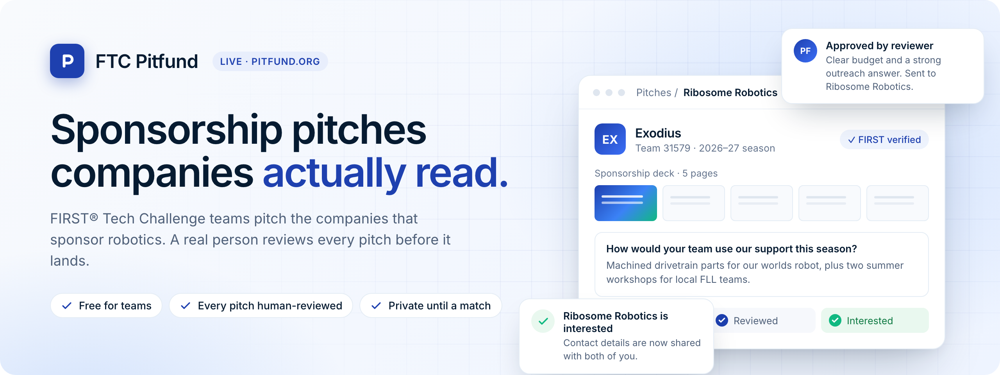
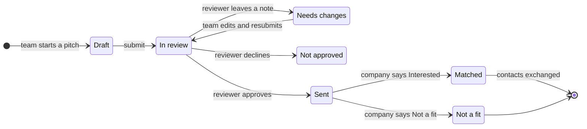
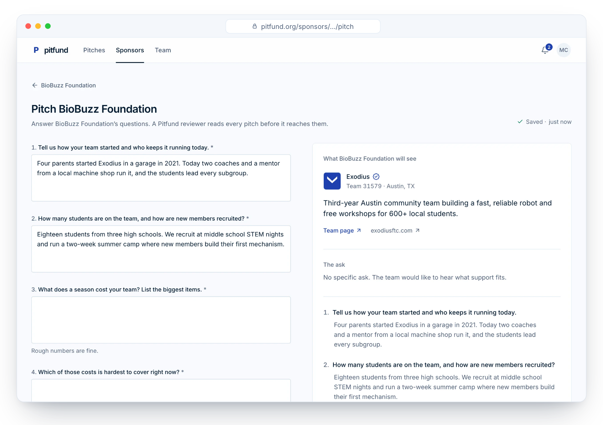
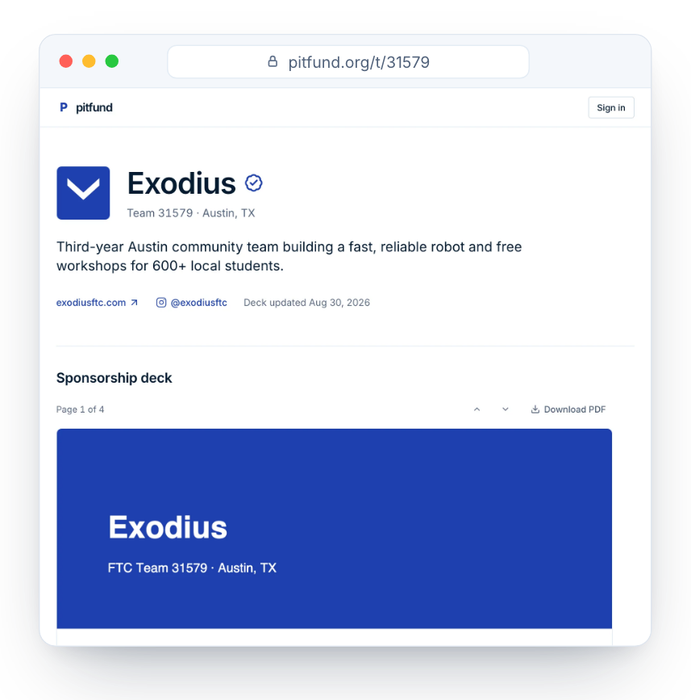
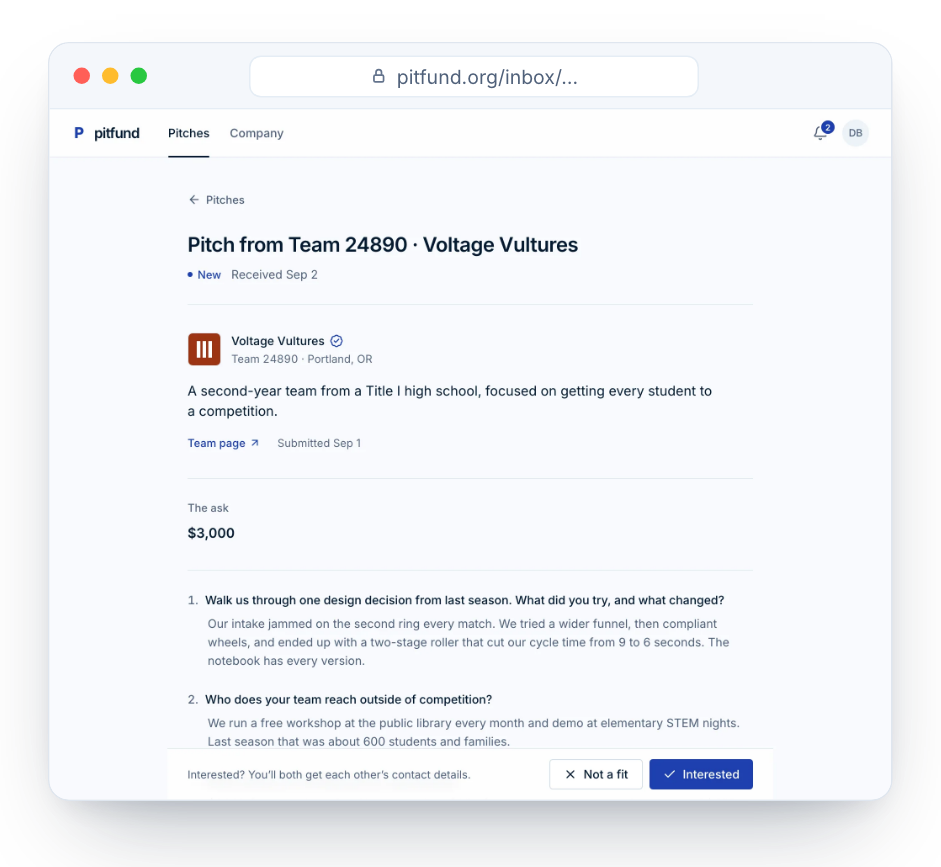
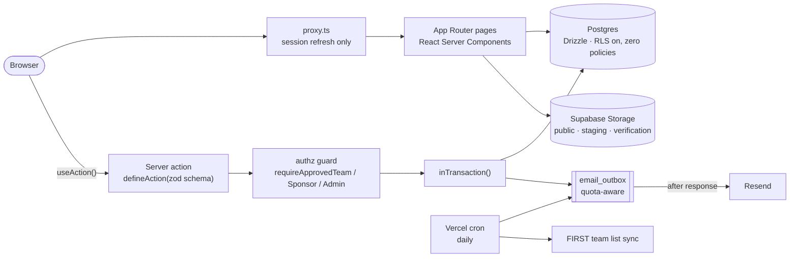

<div align="center">

<a href="https://pitfund.org">
  <picture>
    <source media="(prefers-color-scheme: dark)" srcset=".github/assets/banner-dark.png" />
    
  </picture>
</a>

<br />
<br />

[](https://pitfund.org)
[](https://github.com/AnishYarrakonda/FTC-Pitfund/actions/workflows/ci.yml)
[](https://pitfund.org)


**[Open the app](https://pitfund.org)** · [How it works](#how-it-works) · [Screenshots](#screenshots) · [Run it locally](#run-it-locally) · [Architecture](#architecture) · [Quality bar](#the-quality-bar)

</div>

<br />

## Why Pitfund

Every FIRST® Tech Challenge season, coaches send the same sponsorship deck to dozens of companies and
hear back from almost none. Companies that *want* to sponsor robotics get unvetted cold emails with no
way to compare them.

**FTC Pitfund fixes both sides.** A team uploads its deck once and answers each company's own questions.
A real person reviews every pitch before it reaches the company. The company answers with one click:
**Interested** (contacts are exchanged) or **Not a fit**. Nothing is shared before that, and nobody pays anything.

<table>
<tr>
<td width="33%" valign="top">

### For teams
- Find your team in FIRST's list and verify it once
- One public team page with your deck and summary
- Pitch any approved company, answering *its* questions
- Autosaved drafts; a reviewer's note if something needs fixing
- Track every pitch from draft to answered

</td>
<td width="33%" valign="top">

### For companies
- Write up to ten questions of your own (or keep three good defaults)
- Get only pitches a person has already read
- Read answers next to the team's deck
- Answer **Interested** or **Not a fit**, nothing more
- Contacts are exchanged only on Interested

</td>
<td width="33%" valign="top">

### For reviewers
- Approve teams against FIRST records and companies by hand
- Read each pitch; send it on or return it with a note
- One review queue, one daily digest email
- System page for email quota, cron health and warnings
- Every decision in the audit log

</td>
</tr>
</table>

## How it works



| Rule | Why it matters |
| --- | --- |
| **Teams and companies are approved before they reach the app.** A team proves itself with a FIRST Dashboard screenshot, kept in a private bucket and deleted on approval. | Companies only ever see real, verified teams. |
| **Every pitch is read by a person** before a company sees it. | No spam, and the pitches that arrive are worth reading. |
| **One pitch per team, per company, per season** (seasons start Sept 1). Withdrawing before a reply frees the slot. | Teams pick sponsors that fit instead of blasting everyone. |
| **Contacts are shared only on a match**, only between those two organisations. | Coaches' emails and phones stay private until a company says yes. |
| **Adults only.** Coaches, mentors and parents; no student accounts. | The deck and team page speak for the students. |
| **Sign-in is a 6-digit email code.** No passwords, no third-party sign-in. | Nothing to forget, nothing to leak. |

## Screenshots

<p align="center">
  
  <br />
  <sub><b>The composer.</b> Answer the company's own questions with a live preview of exactly what it will see. Drafts save as you type.</sub>
</p>

<table>
<tr>
<td width="50%" align="center">
  
  <br />
  <sub><b>The public team page.</b> Name, number, logo, one-line summary and the deck, readable page by page. Send it anywhere.</sub>
</td>
<td width="50%" align="center">
  
  <br />
  <sub><b>The company inbox.</b> A reviewed pitch, the team's ask and answers, and two buttons.</sub>
</td>
</tr>
</table>

## Run it locally

You need **Docker Desktop** (running) and **Node 24**. Setup starts a local Supabase stack, writes
`.env.local`, runs the migrations and seeds demo data.

```bash
npm install
npm run setup
npm run dev
```

| Open | What's there |
| --- | --- |
| [`127.0.0.1:3000`](http://127.0.0.1:3000) | The app |
| [`127.0.0.1:3000/dev`](http://127.0.0.1:3000/dev) | One-click sign-in as any of ten personas (coach, sponsor, admin, pending orgs…) |
| [`127.0.0.1:3000/dev/ui`](http://127.0.0.1:3000/dev/ui) | Every component in every state |
| [`127.0.0.1:54324`](http://127.0.0.1:54324) | Mailpit: every email the app sends, sign-in codes included |

Reseed any time with `npm run seed -- --scenario demo|edge|empty`.

## Architecture



Every mutation has the same shape: **validate → guard → transaction (data, audit, in-app
notification, queued email) → send email after the response → revalidate → return a `Result`**.
Server actions never throw to the client, and a unit test fails the build if any action or route
handler skips its guard.

<details>
<summary><b>Stack</b></summary>

<br />

| Layer | Choice |
| --- | --- |
| Framework | Next.js 16 App Router with `cacheComponents`, React 19, TypeScript strict |
| UI | Tailwind v4 tokens, Radix primitives loaded on first use, a small in-house design system |
| Auth | Supabase Auth, 6-digit email OTP |
| Data | Postgres via Drizzle (`postgres` driver); RLS enabled with zero policies, so the REST API exposes nothing |
| Files | Supabase Storage; browser uploads land in `staging`, are re-verified server-side and republished |
| Email | React Email templates, Resend, and an outbox capped at 100/day with per-priority budgets and backoff |
| Bots | Vercel BotID on sign-in |
| Hosting | Vercel Hobby (`iad1`) and one daily cron. The whole thing runs on a $0 budget apart from the domain |

</details>

<details>
<summary><b>Project layout</b></summary>

<br />

```text
app/(public)/              landing, login, legal, public team pages (/t/[number]), invites
app/(app)/(workspace)/     pitches · sponsors · team · inbox · company (approved orgs only)
app/admin/                 review queue, pitch/team/company review, directory, system health
app/actions/               server actions, one file per area
app/api/                   auth email hook, Resend webhook, daily cron, health, revalidate
lib/server/                server-only: db, schema, authz, data/*, email/*, storage, jobs
lib/shared/                client-safe types, labels, season rules, zod schemas
lib/client/                useAction, lazy loaders, PDF and upload helpers
components/ui/             the design system
drizzle/                   generated migrations
scripts/                   setup, seed, provisioning, perf, security scan
tests/                     unit (Vitest) · e2e (Playwright) · qa (UX gate, dead-click audit)
```

</details>

## The quality bar

Nobody click-tests Pitfund by hand; the checks do it. CI runs every gate below on each pull request
and push to `main`, against a throwaway local Supabase stack and with no secrets.

| Gate | What it enforces |
| --- | --- |
| `npm run check` | Typecheck, ESLint with zero warnings, Vitest unit and integration tests against real Postgres |
| `npm run e2e` | Playwright journeys for every role, keyboard-only flows, 375 px tap targets, timed acceptance tests |
| `npm run qa` | Every route × persona × 375 / 768 / 1280 px on three data sets: no console errors, no horizontal scroll, no overflowing text, axe serious/critical clean, every dialog traps focus and closes on Esc |
| `npm run qa:clicks` | Every visible button does something within 150 ms; every link goes somewhere |
| `npm run perf` | ≤170 KB first-load JS per route · Lighthouse mobile on Slow 4G: perf ≥90, a11y ≥95, LCP ≤2 s, CLS ≤0.05 · ≤5 queries and p95 ≤400 ms per authed page |
| `npm run security:scan` | No secrets in build output, the anonymous REST API reads and writes nothing, `/dev` is unreachable in production |
| `npm run knip` | Zero unused files, exports or dependencies |

<details>
<summary><b>All commands</b></summary>

<br />

| Command | What it does |
| --- | --- |
| `npm run setup` | Docker check, `supabase start`, `.env.local`, migrate, seed `demo` |
| `npm run dev` | Dev server on `127.0.0.1:3000` |
| `npm run build` | Production build |
| `npm run seed -- --scenario demo\|edge\|empty` | Idempotent fixtures |
| `npm run db:generate` · `db:migrate` · `db:reset` | Drizzle migrations (refuses remote hosts without explicit confirmation) |
| `npm run email:preview` | Every email template into Mailpit, checked and screenshotted |
| `npm run cron:run` · `email:drain` · `ftc:sync` | Run the daily jobs locally |
| `npm run screenshots:marketing` | Recapture the landing page screenshots |
| `npm run provision` | Build production from `.env.local` (see [`docs/LAUNCH.md`](docs/LAUNCH.md)) |

</details>

## Operating it

Live at **[pitfund.org](https://pitfund.org)** since September 2026. Every push to `main` deploys to production.

- [`docs/RUNBOOK.md`](docs/RUNBOOK.md): daily review, System warnings, backups, admins, secrets, incidents
- [`docs/LAUNCH.md`](docs/LAUNCH.md): how production was provisioned; re-run `npm run provision` after any manual step
- [`CLAUDE.md`](CLAUDE.md) and [`.claude/rules/`](.claude/rules): architecture, data and auth, UX contract, testing

## Credits

Built by **Anish Yarrakonda** for **FTC Team 31579 Exodius**. Idea by **Rishi Jhaveri** (outreach lead)
and **Shreyas Vempati** (team captain).

Questions, or a team or company that wants in: **ftcexodius@gmail.com**

<br />

<div align="center">
<sub>FTC Pitfund is an independent project. Not affiliated with or endorsed by FIRST®.<br />FIRST® and FIRST® Tech Challenge are registered trademarks of FIRST.</sub>
</div>
